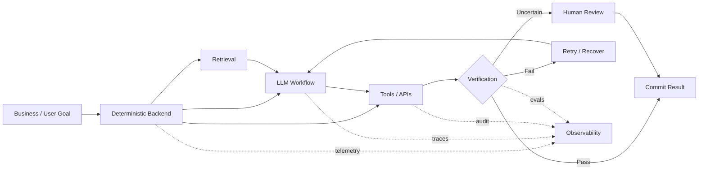

<div align="center">

# YieLab

### Backend engineering for applied AI systems.

**Open-source systems, AI infrastructure, and experiments built with production engineering discipline.**

[Website](https://yielab.com) · [Projects](#projects) · [Engineering principles](#engineering-principles) · [Contact](mailto:info@yielab.com)

<br />

```text
                  YieLab
                    │
        ┌───────────┼───────────┐
        │           │           │
     PRODUCT    AI SYSTEMS    TOOLING
        │           │           │
     Fabulada     Adapta     Tack · Docket
```

</div>

---

## What is YieLab?

YieLab is an independent engineering studio focused on the systems around applied AI.

The work combines **18 years of backend engineering experience** with recent hands-on work in LLM workflows, retrieval, evaluation, model serving, agent tooling, and human-in-the-loop systems.

We care less about adding an LLM to everything and more about the engineering questions that appear once AI has to interact with real software:

**How does it fail? How do we observe it? What can it access? How much can it spend? When should a human take over?**

The repositories below are public implementations and experiments around those questions.

> **Project maturity is explicit.**
>
> Beta means beta. Prototype means prototype. Experimental means experimental.

---

# Projects

<table>
<tr>
<td width="50%" valign="top">

## 🧭 [Tack](https://github.com/yielab/tack)

**Local-first project management system**

`BETA` · `RUST` · `SOLIDJS` · `SQLITE`

A self-hosted project manager distributed as a single binary.

The binary contains the web UI, REST API, CLI and SQLite persistence layer — no external database server required.

**Highlights**

- Kanban, Gantt, sprints and calendar
- Full-text search
- REST API + JSON-capable CLI
- GitHub and Linear import
- Webhooks
- Configurable domain vocabulary
- Cross-platform release binaries

Current work is exploring an **operator-oriented interface for AI-assisted workflows**.

→ **[Source & documentation](https://github.com/yielab/tack)**

</td>

<td width="50%" valign="top">

## 🧠 [Adapta](https://github.com/yielab/adapta)

**Private AI infrastructure on your hardware**

`PROTOTYPE` · `PYTHON` · `FASTAPI` · `RAG`

An open-source prototype for experimenting with private retrieval and model customization.

**Highlights**

- Project-scoped RAG
- Cited retrieval
- OpenAI-compatible API
- Local model serving
- CPU retrieval path
- Experimental LoRA / QLoRA workflows
- Evaluation gates
- GPU training workers
- No application telemetry

Designed around a simple constraint:

> **Private data should not need to leave infrastructure you control.**

→ **[Source & documentation](https://github.com/yielab/adapta)**

</td>
</tr>

<tr>
<td width="50%" valign="top">

## ⚙️ [Docket](https://github.com/yielab/docket)

**Experimental agent execution infrastructure**

`EXPERIMENTAL` · `AGENTS` · `CLI`

Research and tooling around running coding agents with explicit operational boundaries.

Areas being explored include:

- isolated execution contexts
- explicit cost budgets
- auditability
- model selection
- health and drift detection
- human approval boundaries

Docket is currently undergoing a **scope-focused refactor**. Its execution model and public API should be considered unstable.

This is intentionally not presented as production-hardened agent infrastructure.

→ **[Source & current status](https://github.com/yielab/docket)**

</td>

<td width="50%" valign="top">

## 📖 Fabulada

**Public applied-AI product**

`PUBLIC MVP` · `LANGGRAPH` · `LLM WORKFLOWS`

Fabulada is a deployed storytelling application that generates bedtime stories adapted to a family's language variant.

Its workflow separates:

```text
plan → generate → verify → revise / accept
```

rather than relying on a single generation call.

Current engineering work includes image generation, automated moderation, human-in-the-loop fallback, and per-step workflow observability.

→ **[Try Fabulada](https://fabulada.com)**

</td>
</tr>
</table>

---

# The engineering problem

LLM integration is usually the easy part.

Operating it is harder.



YieLab's applied-AI work is primarily concerned with the boundaries around the model:

`retrieval` · `evaluation` · `tool access` · `observability` · `cost` · `failure recovery` · `human control`

---

# Engineering principles

| Principle | What it means |
|---|---|
| **Spec before code** | Public interfaces and important behavior are defined before implementation |
| **Bound the model** | LLMs operate inside explicit tool, data, cost and permission boundaries |
| **Evaluate behavior** | Non-deterministic systems need evaluation, not just unit tests |
| **Observe every boundary** | External calls and workflow steps should be independently traceable |
| **Human when uncertain** | High-impact or ambiguous decisions need an explicit escalation path |
| **Automate verification** | CI, tests, contracts and evals run continuously |
| **State maturity honestly** | Experimental work is not presented as production infrastructure |
| **Measure, don't advertise** | Performance and quality claims should come from reproducible measurements |

---

# How we build

```text
          SPEC
           │
           ▼
      IMPLEMENTATION
           │
      ┌────┴────┐
      │         │
      ▼         ▼
    TESTS      EVALS
      │         │
      └────┬────┘
           ▼
       OBSERVE
           │
           ▼
        RELEASE
           │
           ▼
        LEARN
           │
           └──────────────► SPEC
```

Depending on the project, verification includes:

- unit and integration tests
- API contract tests
- end-to-end tests
- LLM evaluation sets
- structured traces
- CI on every push

The exact guarantees are documented per repository.

---

# Technology

Our current work spans:

**Applied AI**

`LangGraph` · `RAG` · `LLM APIs` · `pgvector` · `ChromaDB` · `llama.cpp` · `LoRA / QLoRA`

**Backend**

`Python` · `FastAPI` · `TypeScript` · `Rust` · `REST` · `WebSockets`

**Data & Infrastructure**

`PostgreSQL` · `SQLite` · `Redis` · `Docker` · `GitHub Actions`

Technology is a means, not the positioning.

The common thread is **backend engineering for systems that include AI**.

---

# Project maturity

| Project | Status | Focus |
|---|---|---|
| **Fabulada** | 🟢 Public MVP | User-facing LLM workflows |
| **Tack** | 🟡 Beta | Local-first systems engineering |
| **Adapta** | 🟠 Prototype | Private RAG & model infrastructure |
| **Docket** | 🔵 Experimental | Bounded agent execution |

Status reflects current maturity, not ambition.

---

# Contributing

These projects are evolving in public.

Look for issues labeled **`good first issue`** or **`help wanted`** in individual repositories.

Bug reports, design discussion and focused pull requests are welcome.

---

<div align="center">

### Build AI systems like software systems.

**Observable · testable · bounded · maintainable**

[yielab.com](https://yielab.com) ·
[GitHub](https://github.com/yielab) ·
[info@yielab.com](mailto:info@yielab.com)

</div>
