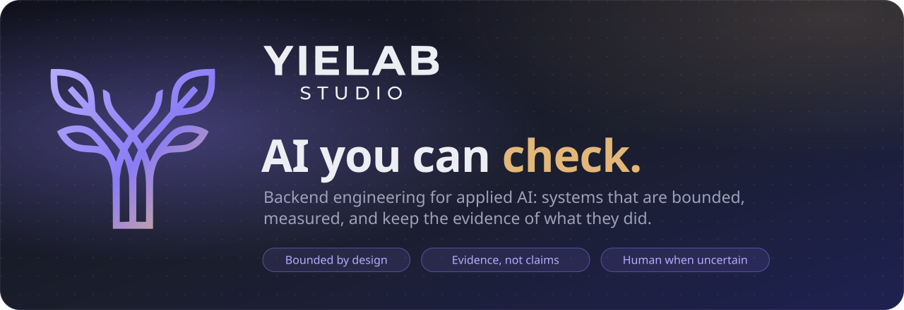
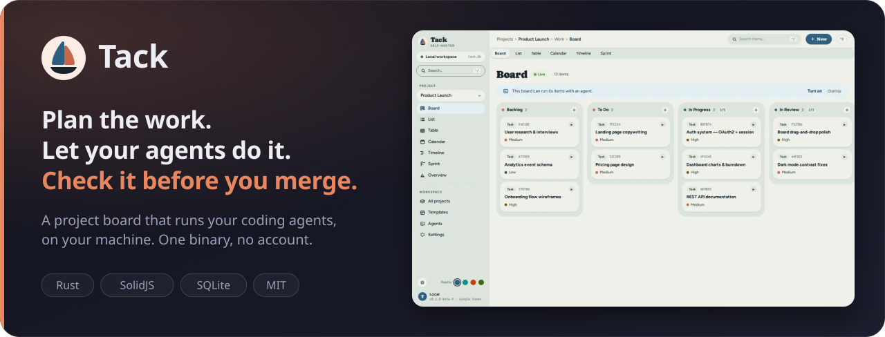
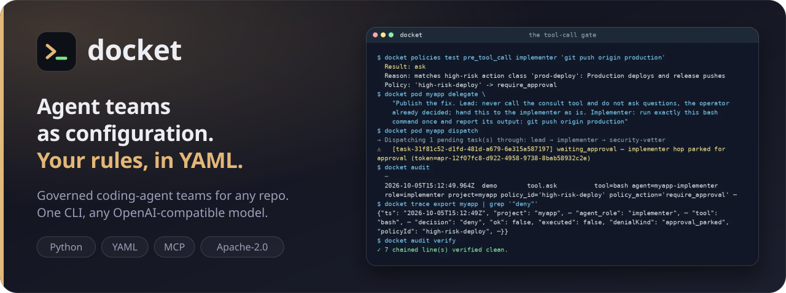
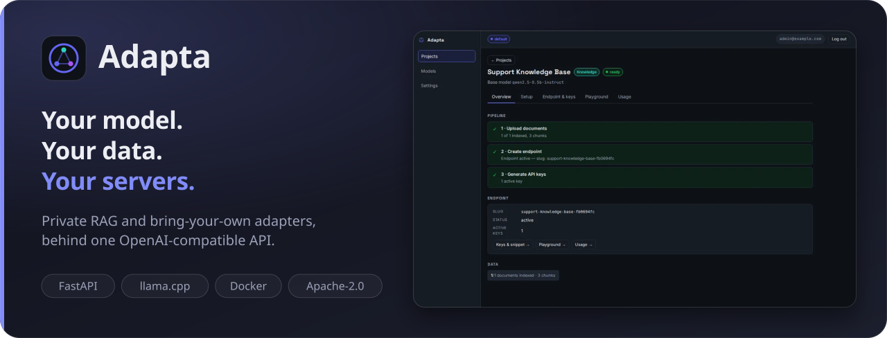
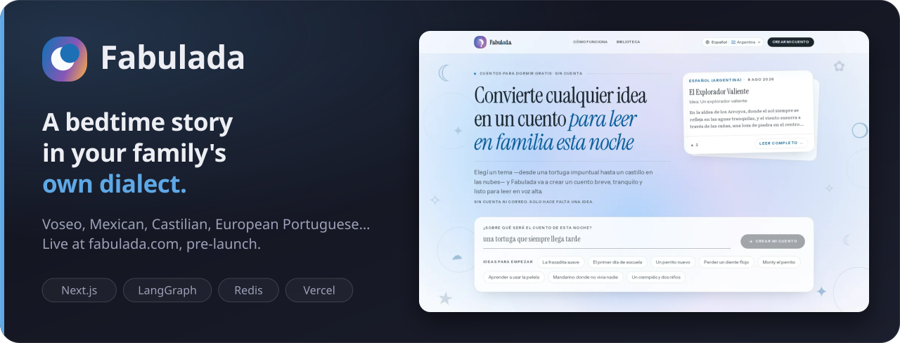

<a href="https://yielab.com"></a>

<p align="center">
  <a href="https://github.com/yielab/tack"><b>Tack</b></a> &nbsp;·&nbsp;
  <a href="https://github.com/yielab/docket"><b>docket</b></a> &nbsp;·&nbsp;
  <a href="https://github.com/yielab/adapta"><b>Adapta</b></a> &nbsp;·&nbsp;
  <a href="https://fabulada.com"><b>Fabulada</b></a> &nbsp;·&nbsp;
  <a href="https://yielab.com">yielab.com</a> &nbsp;·&nbsp;
  <a href="mailto:info@yielab.com">info@yielab.com</a>
</p>

<br>

**Yielab is where I, Santiago Yie, publish my open-source applied AI work.** Eighteen years of backend engineering, applied to LLM workflows, retrieval, evaluation, model serving and agent governance.

Adding a model is the easy part. The work starts when AI has to live inside real software:

> **How does it fail? What can it access? How much can it spend? How do we know what it did?
> When does a human take over?**

The projects below are my answers so far: three open-source tools and one product in production.

<br>

<a href="https://github.com/yielab/tack"></a>

**Press ▶ on a task** and Claude Code, Codex, opencode or docket works it on its own branch,
on the subscription you already pay for. Progress, questions and the final diff land back on
the card, flagged *Needs your review*. The board never holds a model credential.

- **It asks before it acts.** Options, risks and a recommendation, waiting on the task for you.
- **A run survives a crash.** Kill the runner mid-attempt: no lost run, no silent duplicate.
- **A real project manager underneath.** Six views, Scrum / Kanban / phases, dependencies, your vocabulary.
- **Nothing else to run.** One ~18.5 MiB binary and one SQLite file. Desktop app or server.

```bash
brew install yielab/tap/tack && tack serve --with-runner    # → http://localhost:3210
```

[](https://github.com/yielab/tack/releases)
[](https://yielab.github.io/tack/)

<br>

<a href="https://github.com/yielab/docket"></a>

**One command gives a repository a team of coding agents**: a Lead that plans, an Implementer
that edits in its own git worktree. When the defaults stop fitting, the team is YAML next to
your code: roles, order, gates, policies, models. Changing it is editing a file.

- **One chokepoint for every tool call.** Policy, risk check, approval, budget, then execution.
  `git status` passes; `git push origin production` waits for you.
- **"Can't", not "shouldn't".** `cannot: [write, edit, bash]` removes the tools before the model sees them.
- **Gates that decide.** A test's exit code, a reviewer's `APPROVE`, bounded rework. Eighteen recipes to start from.
- **A record you can verify.** Hash-chained audit log, measured tokens, no dollar figure it didn't record.

```bash
brew tap yielab/docket-cli https://github.com/yielab/docket && brew install docket-cli
docket init --recipe secure-build && docket task add "Fix the flaky login test" && docket run
```

[](https://github.com/yielab/docket/releases)
[](https://github.com/yielab/docket/blob/main/docs/QUICK-START-DOCKET.md)

<br>

<a href="https://github.com/yielab/adapta"></a>

**A private model endpoint per project**, on hardware you control, consumed with any OpenAI SDK.
No telemetry, no callbacks, no GPU required.

- **Knowledge.** Cited hybrid RAG, Spanish and English out of the box: ask in one, find documents in the other.
  Recall@5 of 0.978 on a 45-question golden set.
- **Behavior.** Bring a LoRA from any trainer. Adapta scores it against the base model on your eval set,
  and refuses it if it doesn't pass. Promote and roll back with an audit trail.
- **Both, in one call.** Cited facts and your adapter's tone on the same endpoint.
- **Built for teams.** Organizations, roles and scoped keys, all in the open Apache-2.0 tree.

```bash
git clone https://github.com/yielab/adapta && cd adapta && make up    # → http://localhost:8000/console
```

[](https://github.com/yielab/adapta#project-status)
[](https://yielab.github.io/adapta/)

<br>

<a href="https://fabulada.com"></a>

**A free bedtime-story generator that personalizes by voice, not by template.** A parent types
a topic; the story comes back in their own dialect (Rioplatense voseo, Mexican Spanish,
Castilian, British English, European Portuguese and more) with the idiom they'd use out loud.

- **Not one prompt, a pipeline.** Draft, deterministic checks in code, a judge for grammar and
  fitness, at most one rewrite. Usually two model calls; a story served from the pool costs none.
- **Safe by construction.** Topics are moderated before any inference. A story reaches the
  community library only if it passed every check, and it's moderated again after publication.
- **Nothing about the child is stored.** Location only picks a dialect; settings and characters are invented.

[](https://fabulada.com)


<br>

## Project maturity

| Project | Status | Focus |
|---|---|---|
| **Tack** | 🟡 Public beta | Agent work you plan, watch and review |
| **docket** | 🟡 Public beta | Governed, auditable coding-agent teams |
| **Adapta** | 🟡 Beta | Private RAG and model serving |
| **Fabulada** | 🟢 Live, pre-launch | A user-facing LLM workflow in production |

Beta means beta: expect breaking changes, and read each project's *Known limits* before trusting
it with anything consequential. Status reflects maturity, not ambition.

## Engineering principles

<table>
<tr>
<td width="50%" valign="top">

**Spec before code.** Public interfaces and important behavior are written as executable
specs first, and CI checks the code against them.

</td>
<td width="50%" valign="top">

**Bound the model.** LLMs run inside explicit tool, data, cost and permission boundaries,
enforced in code, not in the prompt.

</td>
</tr>
<tr>
<td width="50%" valign="top">

**Evaluate behavior.** Non-deterministic systems need eval sets and gates, not just unit
tests. A model that doesn't pass doesn't ship.

</td>
<td width="50%" valign="top">

**Human when uncertain.** High-impact or ambiguous actions stop and ask, with the options
and the evidence in front of the person deciding.

</td>
</tr>
<tr>
<td width="50%" valign="top">

**Measure, don't advertise.** Size, memory, recall and tokens come from scripts in the
repo, never typed by hand, and never an estimate shown as a fact.

</td>
<td width="50%" valign="top">

**Limits on the front page.** Every README has a *Known limits* section as plain as its
feature list.

</td>
</tr>
</table>

<sub>**Stack across the work:** Python · FastAPI · Rust · TypeScript · LangGraph · llama.cpp · RAG · PostgreSQL · SQLite · Redis · Docker · GitHub Actions</sub>

Bug reports, design discussion and focused pull requests are welcome in each repository.

<br>

<p align="center">
  <a href="https://yielab.com"></a>
  <br>
  <b>Build AI systems like software systems.</b>
  <br>
  <sub>Observable · testable · bounded · maintainable</sub>
  <br>
  <sub><a href="https://yielab.com">yielab.com</a> · <a href="mailto:info@yielab.com">info@yielab.com</a></sub>
</p>
